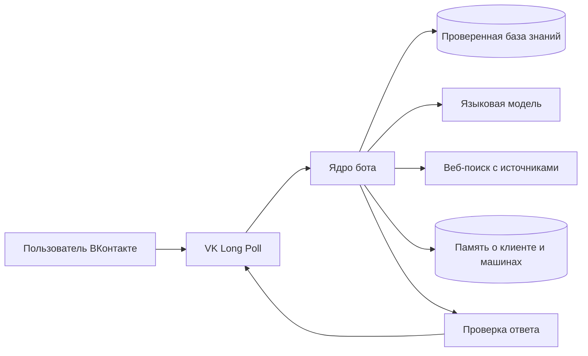
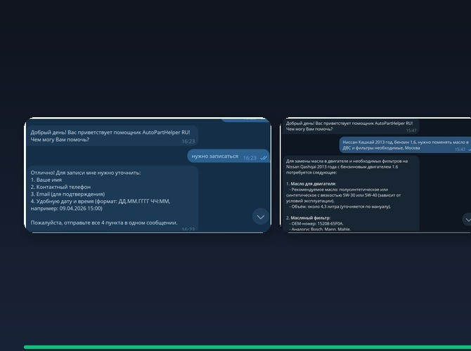

# АвтоГраф — ИИ-помощник автомобилиста во ВКонтакте

> Круглосуточный цифровой помощник в сообщениях сообщества: подбирает запчасти по проверенной базе, понимает голосовые и опечатки, помнит машину человека и ведёт по шагам при ДТП.

[Кейс на сайте](https://www.traders-reflections.ru/autograf.html) · [Живой бот во ВКонтакте](https://vk.me/club242380910) · [Портфолио](https://www.traders-reflections.ru)

## О проекте

АвтоГраф — ИИ-ассистент для автомобилистов. Он отвечает в личных сообщениях сообщества ВКонтакте так, как это делал бы знакомый мастер: спокойно, по делу и без выдуманных номеров деталей.

Проект создан как демонстрация подхода: **языковая модель + проверенная база знаний + защитные проверки**. Модель отвечает за разговор, база — за факты, проверки — за то, чтобы в ответ не попал непроверенный номер детали.

## Задача

Владельцу машины нужно быстро понять, какая деталь нужна и что делать при поломке или ДТП. Обычный чат-бот на языковой модели отвечает уверенно и гладко, но в этой теме у него есть опасная слабость: он может придумать номер детали или её свойства. Человек купит не ту деталь и потеряет деньги и время.

Задача была двойная: живой человеческий разговор и строгость там, где ошибка стоит денег.

## Что умеет

- **Подбор запчастей и ТО** — оригинальные номера и аналоги из проверенной базы; чего нет в базе, бот ищет в интернете и показывает источники.
- **Память** — помнит человека и его машины, учитывает поправки на ходу и понимает опечатки: «калкан» — это Qashqai.
- **Голосовые** — водитель может наговорить вопрос голосом, бот поймёт и ответит.
- **Помощь при ДТП** — сначала безопасность и 112, затем по одному шагу: знак аварийной остановки, когда можно оформить европротокол, что фотографировать, какие сроки у страховой.
- **Вдумчивый разговор** — замечает, если человек повторяет вопрос, и объясняет иначе; переспрашивает, только когда от ответа правда зависит результат.
- **Честность и приватность** — на вопрос «ты бот?» честно отвечает, что он цифровой помощник. По команде «забудь меня» удаляет всё, что знал. Данные хранятся на сервере в России.

## Как устроено

Ключевая идея: модель не отвечает напрямую пользователю. Её ответ проходит через проверки: совпадают ли номера деталей с базой, нет ли выдуманных свойств, не нарушены ли правила безопасности в ветке ДТП.

## Надёжность и экономика

- **126 автоматических проверок** перед каждым обновлением.
- **≈10–15 копеек** — стоимость одного ответа: модель и поиск.
- Дневные лимиты на модель и поиск, лимит сообщений на собеседника.
- Данные о людях и машинах хранятся в России.
- Непроверенный номер детали в ответ не попадает.

## Технологии

`Python` · `VK API` · языковые модели · веб-поиск с источниками · распознавание речи · SQLite · Long Poll

## Скриншоты

## Ссылки

- [Кейс: как устроен АвтоГраф](https://www.traders-reflections.ru/autograf.html)
- [Живой бот во ВКонтакте](https://vk.me/club242380910)
- [Портфолио](https://www.traders-reflections.ru)

## Статус

Демонстрационный проект в портфолио. Исходный код, база знаний, промпты и данные клиентов не публикуются: в них есть бизнес-логика и персональные данные. В репозитории — описание продукта, архитектура и скриншоты.

## Контакты

Telegram: [@Rhodes_4ever](https://t.me/Rhodes_4ever) · Почта: [demetra68@gmail.com](mailto:demetra68@gmail.com)
